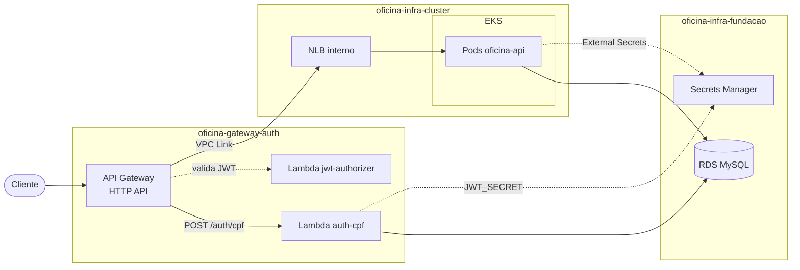

# Oficina Mecânica

Sistema de gestão de oficina mecânica: ordens de serviço do recebimento do veículo à entrega,
orçamento aprovado pelo cliente, estoque de peças e catálogo de serviços. Desenvolvido como
**Tech Challenge da pós-graduação SOAT (Fase 3)**, roda na AWS: API em PHP 8.2 num cluster EKS,
autenticação do cliente por CPF em Lambda, API Gateway na borda e RDS MySQL.

Este é o **repositório principal** do projeto. Ele não tem código de produto: reúne o mapa do
sistema, as regras que valem para todos os repositórios e as ferramentas para operar os quatro
juntos, inclusive com agentes de IA (Claude Code, Codex ou qualquer ferramenta que leia
`AGENTS.md`).

## Repositórios

O sistema se divide pelo **ciclo de vida** dos recursos (ADR-008). O que é durável fica embaixo e
o que muda todo dia fica em cima:

| Ordem | Repositório | O que tem | Stack | Muda |
|---|---|---|---|---|
| 1 | [`oficina-infra-fundacao`](https://github.com/bregaldahq/oficina-infra-fundacao) | VPC, subnets, RDS MySQL, **todos** os segredos, migrations SQL | Terraform | raríssimo |
| 2 | [`oficina-infra-cluster`](https://github.com/bregaldahq/oficina-infra-cluster) | EKS, node group, add-ons Helm, ECR, NLB interno | Terraform | ocasional |
| 3 | [`oficina-gateway-auth`](https://github.com/bregaldahq/oficina-gateway-auth) | API Gateway, VPC Link, Lambdas `auth-cpf` e `jwt-authorizer` | PHP 8.2 (Bref) + Terraform | ocasional |
| 4 | [`oficina-api`](https://github.com/bregaldahq/oficina-api) | API REST (DDD, Clean Architecture), manifests kustomize, Job de migration, documentação da Fase 3 | PHP 8.2 | diário |

`apply` segue a ordem da tabela, `destroy` a inversa. Os repositórios se acoplam **só** por
parâmetros no SSM Parameter Store (`/oficina/<env>/...`), cada um com um único dono.

## Arquitetura



- O cliente se identifica pelo CPF em `POST /auth/cpf` e recebe um JWT `customer`. O admin faz
  login em `POST /api/auth/login` e recebe um JWT `admin`, emitido pela própria API.
- Toda rota `/api/**` protegida passa pelo `jwt-authorizer` no gateway, e a API revalida o token.
- A regra de negócio fica só em `oficina-api`. A máquina de estados da ordem de serviço:
  `RECEIVED → DIAGNOSIS → AWAITING_APPROVAL → EXECUTING → FINISHED → DELIVERED`.

## Documentação

Fica no repositório da aplicação, em `docs/fase-3/`. Este repositório aponta para ela e não copia.

| Documento | Onde |
|---|---|
| Contratos entre repositórios (normativo) | [`CONTRATOS.md`](https://github.com/bregaldahq/oficina-api/blob/develop/docs/fase-3/CONTRATOS.md) |
| Decisões de arquitetura | [`docs/fase-3/adr/`](https://github.com/bregaldahq/oficina-api/tree/develop/docs/fase-3/adr) |
| RFCs | [`docs/fase-3/rfc/`](https://github.com/bregaldahq/oficina-api/tree/develop/docs/fase-3/rfc) |
| Diagramas | [`docs/fase-3/diagramas/`](https://github.com/bregaldahq/oficina-api/tree/develop/docs/fase-3/diagramas) |
| Contrato HTTP (OpenAPI) | [`swagger.yaml`](https://github.com/bregaldahq/oficina-api/blob/develop/swagger.yaml) |
| Fluxos de negócio | [`DOMAIN-STORYTELLING.md`](https://github.com/bregaldahq/oficina-api/blob/develop/docs/DOMAIN-STORYTELLING.md) |
| Modelo de dados | [`MODELO-DE-DADOS.md`](https://github.com/bregaldahq/oficina-infra-fundacao/blob/develop/docs/MODELO-DE-DADOS.md) |
| Como funciona cada repositório, por dentro | [`AGENTS.md`](AGENTS.md) |

## Começando

```bash
git clone https://github.com/bregaldahq/oficina-mecanica.git
cd oficina-mecanica
make setup          # clona os quatro repositórios em repos/
make doctor         # confere Docker, ferramentas, clones e proteções de branch
make verify         # roda o que o CI de cada repo roda, local e sem AWS (~30 s)
claude              # ou o agente de sua preferência, a partir da raiz
```

A máquina só precisa de Docker, `git`, `gh` e `python3`. PHP, Composer, Terraform, tflint e
kustomize vêm da imagem `tooling/Dockerfile`, nas versões do CI, construída na primeira vez que
for usada.

Já tem os repositórios clonados em outro lugar? Em vez de clonar de novo:

```bash
bin/ws link ~/caminho/onde/estao/os/clones
```

## O que tem aqui

| Caminho | Para quê |
|---|---|
| `AGENTS.md` | contexto para qualquer agente: mapa, como cada repo funciona, acoplamento, convenções, regras |
| `CLAUDE.md` | importa o `AGENTS.md` e lista o que é específico do Claude Code |
| `Makefile` | atalhos: `make setup`, `make pull`, `make status`, `make prs`, `make contratos`, `make verify`, `make doctor` |
| `repos.txt` | lista de repositórios, na ordem de apply. Para incluir um repo, adicione uma linha |
| `bin/ws` | operações nos quatro repos: `clone`, `link`, `pull`, `status`, `context`, `prs`, `ci`, `diff`, `grep`, `verify`, `exec`, `branch`, `isolate`, `doctor`, `run` (`bin/ws` sem argumento lista tudo) |
| `bin/verify.py` | o `bin/ws verify`: os passos do `pr.yml` de cada repo, em paralelo, com resultado em `.ws/verify/latest.json` |
| `bin/tooling`, `tooling/Dockerfile` | imagem com PHP 8.2, Composer, Terraform 1.9.8, tflint, kustomize, actionlint e shellcheck |
| `bin/check-contracts.py`, `tools/contratos/` | confere os contratos entre os repos (SSM, segredos, JWT, rotas, migrations, RBAC, nomes antigos) contra o código e o `CONTRATOS.md`; testes em `tests/` |
| `.claude/skills/` | `status-geral`, `mudanca-cross-repo`, `checar-contratos` |
| `.claude/agents/` | `guardiao-de-contratos`, revisor de diffs contra o `CONTRATOS.md` |
| `.claude/settings.json` | libera comandos de leitura, pede confirmação para push e operações git destrutivas, e bloqueia `apply`, `destroy`, `kubectl`/`helm`/`aws` mutantes, merge, deploy manual e leitura de segredos |
| `.claude/hooks/` | `ensure-repos.sh`: em sessão de worktree, liga `repos/` ao do checkout principal |
| `docs/PLANO-HARNESS-IA.md` | plano de evolução do harness de IA |

## Princípios

- **`repos/` não é versionado.** Cada repositório mantém o próprio Git, CI e proteção de branch.
  Este só os enxerga. Nada de submodule.
- **Uma fonte da verdade.** O contrato entre os repositórios é o `CONTRATOS.md` da aplicação.
  Este repositório aponta para ele, não copia.
- **Agente não muda infra.** Infra muda pelo CI de cada repositório. Daqui, o agente lê, edita,
  testa e abre PR.

## Nomes antigos

Os repositórios foram renomeados em novembro de 2026. O GitHub redireciona as URLs antigas.

| Antes | Agora |
|---|---|
| `oficina-workspace` | `oficina-mecanica` |
| `oficina-infra-database` | `oficina-infra-fundacao` |
| `oficina-infra-k8s` | `oficina-infra-cluster` |
| `oficina-lambda-auth` | `oficina-gateway-auth` |
| `oficina-mecanica-tech-challenge` | `oficina-api` |

Três coisas **continuam** com o nome antigo, de propósito: a chave do state do Terraform
(`oficina/<nome-antigo>/<env>/terraform.tfstate`), os roles de CI na AWS
(`oficina-gha-<nome-antigo>`) e a tag `Repo` dos recursos. Mudar qualquer uma delas exige
migração de state, recriação de role ou um apply que troca todos os nodes do cluster.
