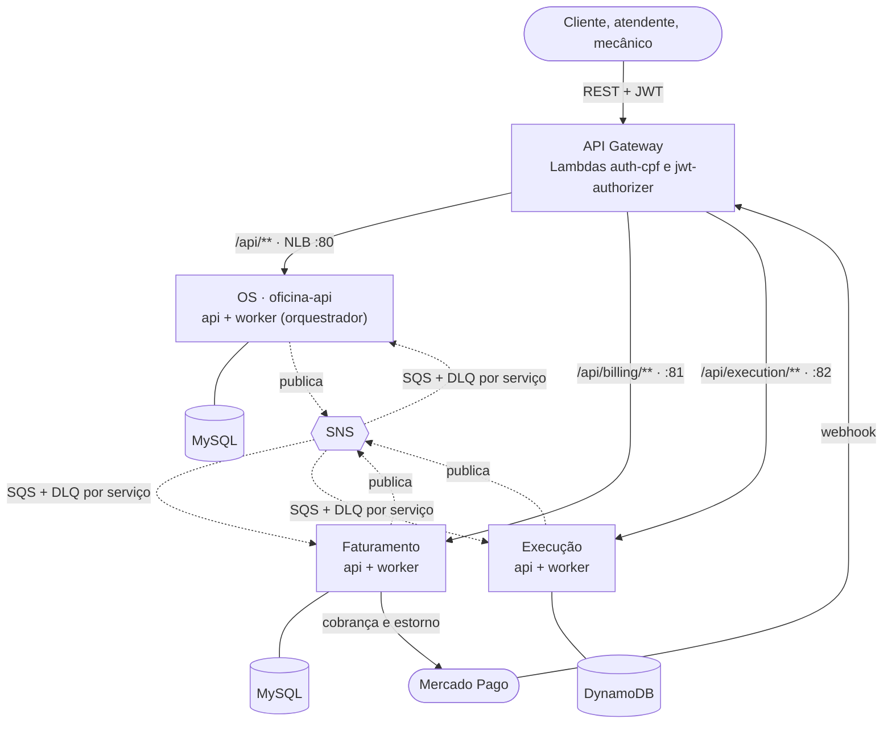

# Oficina Mecânica

Sistema de gestão de oficina mecânica: ordens de serviço do recebimento do veículo à entrega,
diagnóstico, orçamento aprovado pelo cliente, pagamento pelo Mercado Pago, estoque de peças e
reparo. Desenvolvido como **Tech Challenge da pós-graduação SOAT**. Na **Fase 4** o sistema virou
**três microsserviços**, cada um com repositório, banco, infraestrutura e pipeline próprios,
coordenados por uma **saga orquestrada** sobre mensageria (SNS + SQS), na AWS (EKS, API Gateway,
Lambda, RDS MySQL e DynamoDB).

Este é o **repositório principal** do projeto. Ele não tem código de produto: reúne o mapa do
sistema, as regras que valem para todos os repositórios, as ferramentas para operar os seis
juntos (inclusive com agentes de IA: Claude Code, Codex ou qualquer ferramenta que leia
`AGENTS.md`) e a [**entrega da Fase 4**](docs/entrega/ENTREGA-FASE-4.pdf).

## Repositórios

| Ordem | Repositório | O que tem | Banco | Stack |
|---|---|---|---|---|
| 1 | [`oficina-infra-fundacao`](https://github.com/bregaldahq/oficina-infra-fundacao) | VPC, subnets, RDS do OS, segredos compartilhados, tópico SNS, migrations do OS | — | Terraform |
| 2 | [`oficina-infra-cluster`](https://github.com/bregaldahq/oficina-infra-cluster) | EKS, node group, add-ons Helm, ECR do OS, NLB interno com um listener por serviço | — | Terraform |
| 3 | [`oficina-gateway-auth`](https://github.com/bregaldahq/oficina-gateway-auth) | API Gateway (um prefixo por serviço), VPC Link, Lambdas `auth-cpf` e `jwt-authorizer` | — | PHP 8.2 (Bref) + Terraform |
| 4 | [`oficina-api`](https://github.com/bregaldahq/oficina-api) | **Serviço de OS**: clientes, veículos, ordem de serviço, login do admin e **orquestrador da saga**; contrato e ADRs | MySQL (RDS da fundação) | PHP 8.2 + Terraform |
| 5 | [`oficina-faturamento`](https://github.com/bregaldahq/oficina-faturamento) | **Faturamento**: catálogo, estoque, orçamento, aprovação, pagamento pelo Mercado Pago, estorno | MySQL próprio | PHP 8.2 + Terraform |
| 6 | [`oficina-execucao`](https://github.com/bregaldahq/oficina-execucao) | **Execução**: fila da oficina, diagnóstico e reparo | DynamoDB | PHP 8.2 + Terraform |

`apply` segue a ordem da tabela, `destroy` a inversa. A infraestrutura se acopla **só** por
parâmetros no SSM Parameter Store (`/oficina/<env>/...`), cada um com um único dono; os serviços
conversam **só** por mensagens, nunca pelo banco nem pela API um do outro.

## Arquitetura



- **A saga da OS** atravessa os três serviços: diagnóstico (Execução) → orçamento com peças
  reservadas (Faturamento) → aprovação do cliente → pagamento (Mercado Pago) → reparo (Execução).
  Cada passo tem compensação: se algo falha, a saga estorna o pagamento, devolve as peças e
  cancela a tarefa. **Por que orquestrada:** [ADR-012](https://github.com/bregaldahq/oficina-api/blob/develop/docs/fase-4/adr/012-saga-orquestrada-no-servico-de-os.md)
  e o [README do OS](https://github.com/bregaldahq/oficina-api#a-saga-e-por-que-ela-é-orquestrada).
- **Outbox e inbox** em cada serviço: estado e mensagem gravados juntos; mensagem repetida não
  repete efeito ([ADR-017](https://github.com/bregaldahq/oficina-api/blob/develop/docs/fase-4/adr/017-outbox-inbox-e-idempotencia.md)).
- **Autenticação:** o cliente entra pelo CPF (`POST /auth/cpf`, Lambda que consulta o OS pela
  rota interna) e o admin em `POST /api/auth/login`; o mesmo JWT vale nos três serviços, cada um
  revalida.
- **Qualidade:** cobertura acima de 90% nos três (mínimo de 80% no CI), BDD com Behat, PHPStan
  nível 8 e SonarCloud no `pr.yml` de cada um.
- **Observabilidade:** New Relic com rastreamento distribuído pela fila, eventos da saga,
  dashboard e alertas ([`docs/fase-4/newrelic/`](https://github.com/bregaldahq/oficina-api/tree/develop/docs/fase-4/newrelic)).

## Rodar tudo sem AWS

```bash
bin/ws verify --image   # o que o CI de cada repo roda (lint, testes, cobertura, BDD, imagens, Terraform), ~1 min
bin/ws e2e              # ponta a ponta: a Fase 3 e a saga inteira pelos três serviços (LocalStack), ~4 min
bin/ws e2e --postman    # a coleção Postman da Fase 4 inteira, pelos três serviços, ~4 min
```

## Documentação

| Documento | Onde |
|---|---|
| **Entrega da Fase 4 (PDF)** | [`docs/entrega/ENTREGA-FASE-4.pdf`](docs/entrega/ENTREGA-FASE-4.pdf) |
| Contrato da Fase 4 (normativo: rotas, mensagens, saga, bancos, CI/CD) | [`docs/fase-4/CONTRATOS.md`](https://github.com/bregaldahq/oficina-api/blob/develop/docs/fase-4/CONTRATOS.md) |
| Decisões da Fase 4 (ADRs 011 a 017) | [`docs/fase-4/adr/`](https://github.com/bregaldahq/oficina-api/tree/develop/docs/fase-4/adr) |
| Diagramas da Fase 4 (arquitetura e saga) | [`docs/fase-4/diagramas/`](https://github.com/bregaldahq/oficina-api/tree/develop/docs/fase-4/diagramas) |
| Coleção Postman da saga | [`docs/fase-4/postman/`](https://github.com/bregaldahq/oficina-api/tree/develop/docs/fase-4/postman) |
| Swagger de cada serviço | [OS](https://github.com/bregaldahq/oficina-api/blob/develop/swagger.yaml) · [Faturamento](https://github.com/bregaldahq/oficina-faturamento/blob/develop/swagger.yaml) · [Execução](https://github.com/bregaldahq/oficina-execucao/blob/develop/swagger.yaml) |
| Contrato e decisões da Fase 3 | [`docs/fase-3/`](https://github.com/bregaldahq/oficina-api/tree/develop/docs/fase-3) |
| Fluxos de negócio | [`DOMAIN-STORYTELLING.md`](https://github.com/bregaldahq/oficina-api/blob/develop/docs/DOMAIN-STORYTELLING.md) |
| Modelo de dados do OS | [`MODELO-DE-DADOS.md`](https://github.com/bregaldahq/oficina-infra-fundacao/blob/develop/docs/MODELO-DE-DADOS.md) |
| Plano e andamento da Fase 4 | [`docs/PLANO-FASE-4.md`](docs/PLANO-FASE-4.md) |
| Como funciona cada repositório, por dentro | [`AGENTS.md`](AGENTS.md) |

## Começando

```bash
git clone https://github.com/bregaldahq/oficina-mecanica.git
cd oficina-mecanica
make setup          # clona os seis repositórios em repos/
make doctor         # confere Docker, ferramentas, clones e proteções de branch
make verify         # roda o que o CI de cada repo roda, local e sem AWS (~30 s)
bin/ws hooks install  # git hooks de convenção (commit-msg, pre-push) nos seis repositórios e neste
claude              # ou o agente de sua preferência, a partir da raiz
```

A máquina só precisa de Docker, `git`, `gh` e `python3`. PHP, Composer, Terraform, tflint e
kustomize vêm da imagem `tooling/Dockerfile`, nas versões do CI, construída na primeira vez que
for usada.

Já tem os repositórios clonados em outro lugar? Em vez de clonar de novo:

```bash
bin/ws link ~/caminho/onde/estao/os/clones
```

## O que tem aqui

| Caminho | Para quê |
|---|---|
| `AGENTS.md` | contexto para qualquer agente: mapa, como cada repo funciona, acoplamento, convenções, regras |
| `CLAUDE.md` | importa o `AGENTS.md` e lista o que é específico do Claude Code |
| `Makefile` | atalhos: `make setup`, `make pull`, `make status`, `make prs`, `make contratos`, `make verify`, `make doctor` |
| `repos.txt` | lista de repositórios, na ordem de apply. Para incluir um repo, adicione uma linha |
| `bin/ws` | operações nos seis repos: `clone`, `link`, `pull`, `status`, `context`, `prs`, `ci`, `diff`, `grep`, `verify`, `exec`, `branch`, `isolate`, `doctor`, `run` (`bin/ws` sem argumento lista tudo) |
| `bin/e2e.py`, `bin/e2e_fase4.py`, `bin/e2e_postman.py` | o `bin/ws e2e`: ponta a ponta sem AWS, com LocalStack, e a coleção Postman pelos três serviços |
| `bin/verify.py` | o `bin/ws verify`: os passos do `pr.yml` de cada repo, em paralelo, com resultado em `.ws/verify/latest.json` |
| `bin/tooling`, `tooling/Dockerfile` | imagem com PHP 8.2, Composer, Terraform 1.9.8, tflint, kustomize, actionlint e shellcheck |
| `bin/check-contracts.py`, `tools/contratos/` | confere os contratos entre os repos (SSM, segredos, JWT, rotas, migrations, RBAC, nomes antigos) contra o código e o `CONTRATOS.md`; testes em `tests/` |
| `.claude/skills/` | 15 comandos (`/verificar`, `/nova-migration`, `/abrir-prs`...); o catálogo está em "Comandos" no `AGENTS.md` |
| `.claude/agents/` | `guardiao-de-contratos`, `revisor-ddd`, `revisor-terraform` e `verificador` |
| `.claude/settings.json` | libera comandos de leitura, pede confirmação para push e operações git destrutivas, e bloqueia `apply`, `destroy`, `kubectl`/`helm`/`aws` mutantes, merge, deploy manual e leitura de segredos |
| `.claude/hooks/` | guarda de Bash e de edição, lembretes de contrato, `verify` ao encerrar e retrato dos repos no início da sessão (`AGENTS.md`, "Guardrails executados") |
| `githooks/` | `commit-msg` e `pre-push` para os seis repos e este: `bin/ws hooks install` |
| `tests/` | testes do checker, dos hooks e do contexto (`python3 -m unittest discover -s tests`) |
| `evals/` | tarefas-canário com nota determinística, para medir mudanças no harness (`bin/ws eval`) |
| `templates/pr-body.md` | corpo dos PRs abertos pelo `/abrir-prs` |
| `bootstrap/aws/` | o que a conta AWS precisa antes de qualquer CI: bucket e lock do state, OIDC do GitHub, roles de CI e o role só-leitura do agente. Você aplica uma vez, à mão (ver o README dele) |
| `docs/PLANO-HARNESS-IA.md` | plano de evolução do harness de IA |
| `docs/entrega/` | o PDF de entrega da Fase 4 e a fonte dele (`gerar.py`) |
| `docs/ROTEIRO-ENTREGA.md` | o que falta para pôr a Fase 4 no ar: proteção de branch, segredos, conta AWS, merges, conferência e destroy |

## Princípios

- **`repos/` não é versionado.** Cada repositório mantém o próprio Git, CI e proteção de branch.
  Este só os enxerga. Nada de submodule.
- **Uma fonte da verdade.** O contrato entre os repositórios é o `CONTRATOS.md` da aplicação.
  Este repositório aponta para ele, não copia.
- **Agente não muda infra.** Infra muda pelo CI de cada repositório. Daqui, o agente lê, edita,
  testa e abre PR.

## Nomes antigos

Os repositórios foram renomeados em novembro de 2026. O GitHub redireciona as URLs antigas.

| Antes | Agora |
|---|---|
| `oficina-workspace` | `oficina-mecanica` |
| `oficina-infra-database` | `oficina-infra-fundacao` |
| `oficina-infra-k8s` | `oficina-infra-cluster` |
| `oficina-lambda-auth` | `oficina-gateway-auth` |
| `oficina-mecanica-tech-challenge` | `oficina-api` |

Três coisas **continuam** com o nome antigo, de propósito: a chave do state do Terraform
(`oficina/<nome-antigo>/<env>/terraform.tfstate`), os roles de CI na AWS
(`oficina-gha-<nome-antigo>`) e a tag `Repo` dos recursos. Mudar qualquer uma delas exige
migração de state, recriação de role ou um apply que troca todos os nodes do cluster.
