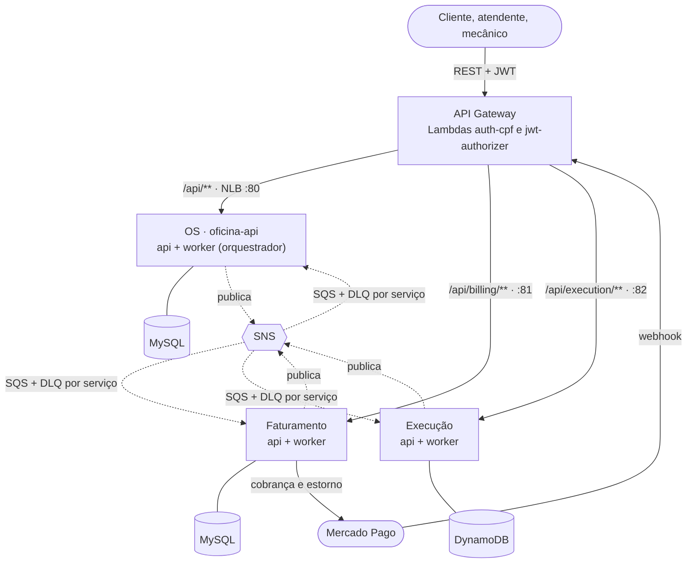

# Oficina Mecânica — Tech Challenge SOAT, Fase 4

**Microsserviços, saga e CI/CD por serviço**

| | |
|---|---|
| Autor | Ricardo Bregalda |
| RM | _a preencher_ |
| Vídeo (até 15 min) | _a preencher_ |
| Repositório principal | <https://github.com/bregaldahq/oficina-mecanica> |

## 1. Repositórios

| Repositório | Papel | Banco |
|---|---|---|
| [oficina-api](https://github.com/bregaldahq/oficina-api) | **Serviço de OS**: clientes, veículos, ordem de serviço, login do admin e **orquestrador da saga** | MySQL (RDS da fundação) |
| [oficina-faturamento](https://github.com/bregaldahq/oficina-faturamento) | **Faturamento**: catálogo, estoque, orçamento, aprovação, pagamento pelo Mercado Pago, estorno | MySQL próprio (RDS do serviço) |
| [oficina-execucao](https://github.com/bregaldahq/oficina-execucao) | **Execução**: fila da oficina, diagnóstico e reparo | DynamoDB |
| [oficina-infra-fundacao](https://github.com/bregaldahq/oficina-infra-fundacao) | VPC, RDS do OS, segredos compartilhados, tópico SNS, migrations do OS | — |
| [oficina-infra-cluster](https://github.com/bregaldahq/oficina-infra-cluster) | EKS, NLB interno com um listener por serviço, External Secrets, New Relic | — |
| [oficina-gateway-auth](https://github.com/bregaldahq/oficina-gateway-auth) | API Gateway, Lambdas `auth-cpf` e `jwt-authorizer` | — |

Cada serviço tem repositório, banco, infraestrutura (`infra/`, Terraform), manifestos
(`deploy/`, kustomize), Dockerfile, Swagger e pipelines próprios. Nenhum serviço lê o banco de
outro.

## 2. Arquitetura

Versão resumida; o diagrama completo, com sub-redes, listeners e filas, está em
`oficina-api/docs/fase-4/diagramas/arquitetura.md`.

- **REST** do cliente para cada serviço, pelo API Gateway: `/api/...` (OS), `/api/billing/...`
  (Faturamento) e `/api/execution/...` (Execução). Cada prefixo vai para um listener próprio do
  NLB interno.
- **Mensageria** entre os serviços: um tópico SNS e, por serviço, uma fila SQS com DLQ e filtro
  pelo tipo da mensagem. Os serviços não se chamam por HTTP.
- **Única chamada síncrona interna:** a Lambda `auth-cpf` consulta o cliente na rota interna do
  OS (`GET /internal/customers/by-document/{cpf}`, com token interno), e não mais no banco dele.
- **Outbox e inbox** (ADR-017): estado e mensagem são gravados na mesma transação; quem consome
  registra o id da mensagem na mesma transação do efeito, e mensagem repetida não repete efeito.

### Bancos: um SQL e um NoSQL

- **OS e Faturamento em MySQL.** Ordem de serviço, orçamento e estoque são relacionais e
  transacionais: reservar peças e gerar o orçamento acontecem na mesma transação, e é isso que dá
  à saga uma compensação real (liberar a reserva).
- **Execução em DynamoDB.** A tarefa da oficina é um documento (itens do diagnóstico, linha do
  tempo) lido por chave e por status, sem junção; sob demanda, custa zero parado. Outbox e inbox
  entram na mesma `TransactWriteItems` da tarefa.

## 3. A saga

Abrir uma OS inicia uma saga que atravessa os três serviços:

<!-- diagrama: saga-caminho-feliz -->

### Por que orquestrada, e não coreografada (ADR-012)

- **O fluxo é linear, longo e tem espera humana** (aprovação do cliente, pagamento) e prazos. Com
  um orquestrador, a ordem dos passos, os prazos e as compensações ficam num arquivo só
  (`SagaOrchestrator`), testado em BDD. Na coreografia ficariam espalhados por três repositórios,
  e o prazo de aprovação não teria dono.
- **O orquestrador mora no serviço de OS**, porque tudo o que a saga faz muda o status da OS. O
  estado da saga e o status da OS mudam na mesma transação, junto com o próximo comando na outbox.
- **Custo aceito:** o OS conhece os comandos dos outros dois serviços. Conhece só o contrato das
  mensagens, nunca o banco nem a API deles.

### Compensações

| Falha | O que a saga desfaz | Status final da OS |
|---|---|---|
| diagnóstico sem conserto | nada (a Execução já encerrou a tarefa) | `CANCELLED` |
| orçamento não gerado (sem estoque, item inexistente) | cancela a tarefa | `CANCELLED` |
| cliente recusa o orçamento | cancela a tarefa (o Faturamento já liberou as peças) | `REJECTED` |
| prazo de aprovação ou de pagamento vencido, pagamento recusado | cancela o orçamento (devolve as peças) e a tarefa | `CANCELLED` |
| reparo falha depois do pagamento | **estorna o pagamento** e cancela o orçamento | `CANCELLED` |
| admin cancela | o que já existe naquele passo | `CANCELLED` |

A OS muda de status na hora; a saga fica em `COMPENSATING` até cada compensação ser confirmada.
Compensação sem confirmação é reenviada com espera crescente e, esgotadas as tentativas, a saga
fica `FAILED` e gera alerta. Todo pagamento aprovado ou faz a OS avançar, ou é estornado: um
pagamento que chega depois do cancelamento volta automaticamente.

<!-- diagrama: saga-reparo-falha -->

## 4. Pagamento: Mercado Pago

Checkout Pro (ADR-015). Aprovado o orçamento, o Faturamento cria a preferência de pagamento e a
saga grava o link na OS. O webhook do Mercado Pago tem a assinatura conferida e só diz qual
pagamento olhar: o estado vem sempre da consulta à API do Mercado Pago. Cobrança e estorno usam
chave de idempotência.

## 5. Qualidade

| Serviço | Testes | Cobertura de linhas de `src/` | BDD (Behat) |
|---|---|---|---|
| OS | 237 | 92,2% | 6 cenários da saga: fluxo completo, reparo que falha e é estornado, orçamento recusado, prazo vencido, compensação que nunca confirma, evento repetido ou fora de hora |
| Faturamento | 178 | 92,8% | 7 cenários: fluxo completo, estoque insuficiente, recusa, compensação do reparo, prazo vencido com pagamento confirmado, pagamento depois do cancelamento, aviso repetido do Mercado Pago |
| Execução | 139 | 95,1% | 5 cenários: fluxo completo, falha do reparo, cancelamento por compensação, mensagem duplicada, compensação repetida |

- O `pr.yml` de cada serviço falha abaixo de **80%** de cobertura, escreve a cobertura no resumo
  do run e guarda o relatório como artefato. O `deploy.yml` roda os testes de novo antes de
  implantar.
- **SonarCloud** com quality gate no PR de cada serviço; PHPStan nível 8 e PSR-12.
- **Ponta a ponta sem AWS:** `bin/ws e2e`, no repositório principal, sobe os três serviços com os
  próprios bancos e um LocalStack (SNS, SQS, DynamoDB) e percorre a saga inteira: caminho feliz,
  reparo que falha com estorno e devolução de peças, e cancelamento pelo admin (107 checagens).
  `bin/ws e2e --postman` roda a coleção Postman inteira pelos três serviços, por um gateway local
  (40 requisições).

## 6. CI/CD

| Workflow | Passos |
|---|---|
| `pr.yml` | php-cs-fixer, PHPStan, PHPUnit com cobertura mínima de 80%, Behat, SonarCloud, build da imagem, `kustomize build`, `terraform fmt` e `validate` do `infra/` |
| `deploy.yml` | OIDC (sem access key) → `terraform apply` do `infra/` → imagem no ECR → migration → `kubectl apply -k` → rollout → smoke → marcação do deploy no New Relic |

Cada serviço tem pipeline própria e independente. `main` (produção) e `develop` (homologação)
são protegidas: só entram por PR, com as checagens verdes.

## 7. Observabilidade

New Relic, como na Fase 3, mais:

- **Rastreamento distribuído pela fila:** quem publica grava o contexto de trace no envelope da
  mensagem; o worker de cada serviço abre uma transação por mensagem que continua esse trace.
- **Eventos de negócio:** `SagaStarted`, `SagaStepCompleted` (com o tempo do passo),
  `SagaCompensated`, `SagaFailed` e `PaymentConfirmed`.
- **Dashboard "Saga":** funil por passo, tempo por passo, compensações por motivo, mensagens por
  serviço e resultado, DLQs e sagas paradas.
- **Alertas:** mensagem na DLQ, saga `FAILED`, saga parada além do prazo, taxa de compensação,
  erro no webhook do Mercado Pago e worker falhando.
- Log JSON com `correlation_id`, `saga_id` e `os_id`.

## 8. Documentação

| O quê | Onde |
|---|---|
| Contrato entre os serviços (rotas, mensagens, saga, bancos, CI/CD) | `oficina-api/docs/fase-4/CONTRATOS.md` |
| Decisões | ADRs 011 a 017 em `oficina-api/docs/fase-4/adr/` |
| Diagramas | `oficina-api/docs/fase-4/diagramas/` |
| API | `swagger.yaml` de cada serviço (Swagger UI em `/docs/`, `/api/billing/docs/`, `/api/execution/docs/`) |
| Postman | `oficina-api/docs/fase-4/postman/`: a saga pelos três serviços, pelo gateway |
| Dashboards e alertas | `oficina-api/docs/fase-4/newrelic/` |

### Decisões (ADRs)

| ADR | Decisão |
|---|---|
| 011 | Três microsserviços: OS, Faturamento e Execução |
| 012 | Saga orquestrada, com o orquestrador no serviço de OS |
| 013 | Mensageria com SNS e SQS (fila e DLQ por serviço, filtro por tipo) |
| 014 | Um banco por serviço: MySQL, MySQL e DynamoDB |
| 015 | Pagamento com Mercado Pago (Checkout Pro) |
| 016 | Seis repositórios; a infraestrutura de cada serviço junto dele |
| 017 | Outbox, inbox e idempotência |

## Anexo: status da ordem de serviço

<!-- diagrama: status-da-os -->
